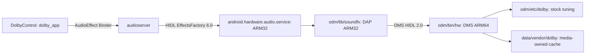
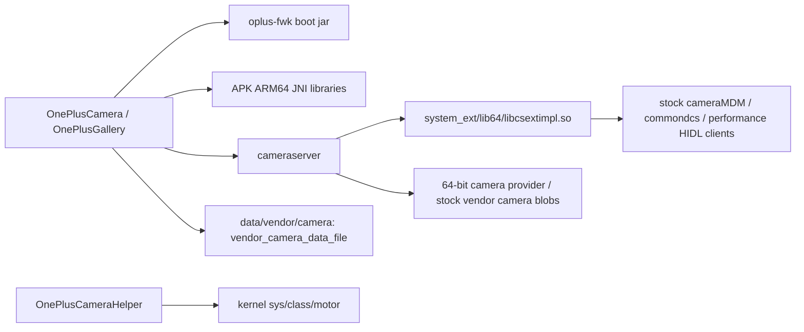

# Stock camera/gallery and Dolby port integration

The product wiring starts in `device/oneplus/guacamole/device.mk`. Keep these
paths together when moving or regenerating repositories; module names alone do
not describe the installed paths or the process that loads a blob.

## Dolby



- `sm8150-common/common.mk` selects the HIDL audio/effect service. The platform
  service defaults to `prefer32`; guacamole also has a 32-bit ODM primary audio
  HAL prebuilt. Changing this service to 64-bit is not required for the port.
- `vendor/oneplus/dolby-guacamole/Android.bp` installs the DMS service as ARM64,
  and its client, storage and effect libraries for both ARM and ARM64. The stock
  `system/system/euclid/odm.img` contains the ARM copies too. Expanding only the
  dump's outer ODM directory is not sufficient for extraction.
- `dolby.mk` installs `/odm/etc/audio_effects.xml`, DAP modules, the service/init
  and VINTF modules, tuning and DolbyControl. It also includes app policy so
  `TARGET_ENABLE_ONEPLUS_DOLBY=false` removes the app and its policy together.
- The effect XML proxy UUID matches the Java binding. Its software/hardware UUIDs
  match the stock ELF descriptors. Effects load from the host architecture's
  `soundfx` directory; a 32-bit HAL cannot load an ARM64-only effect.
- `hardware/oplus-guacamole/sepolicy/qti` labels IDms and its executable, grants
  the audio HAL/codec client relationship, and labels the properties actually
  read by the DAP/storage binaries. The Java control app does not call IDms.
- Dolby init creates the cache and recursively applies the active file-context
  label, including files preserved from previous policy versions.

## Camera and gallery



- `vendor/oplus/camera-guacamole/opluscamera.mk` installs and platform-signs the
  three APKs on system_ext, their permission lists and the extension libraries.
  The `guacamole_` module prefix leaves the installed SONAMEs unchanged.
- `sm8150-common/common.mk` adds `oplus-fwk` to the boot jars and selects
  `hardware/oplus-guacamole`. The vendor/common namespace must use the same
  hardware tree as its extraction script; importing the 13T hardware tree is a
  different dependency graph.
- `hardware/oplus-guacamole/oplus-fwk` provides the stock compatibility surface.
  Generated `com.oneplus.inner` verification stubs throw if called; their stock
  callers use the reflection fallback while `ro.sys.oneplus.support` is unset.
  Do not enable the dynamic wrapper feature merely because the stub types exist.
- `vendor/extraPatches` supplies the camera-service extension hook and the libgui
  buffer-slot configuration support. The camera product sets that limit to 96.
- The app's domain is declared in system_ext policy with `app_domain`; vendor
  data/FastRPC grants live in vendor policy. Common init creates the camera and
  slogan directories with stock DAC modes and relabels existing cache files.
- OnePlusCameraHelper handles the pop-up motor. The face HAL in hardware/oneplus
  is a separate client of the same camera stack, not a replacement provider.

## Checks and remaining device validation

From the ROM root, after extracting the blobs:

```sh
python3 device/oneplus/guacamole/tests/test_port_links.py
python3 vendor/oneplus/dolby-guacamole/tests/host/test_keeper.py
python3 vendor/extraPatches/tests/patches/test_patch_setup.py
```

The integration check evaluates only small product configuration fragments with
GNU make; it does not run Soong or compile Android. It checks both Dolby ELF ABIs
and DT_NEEDED declarations, extraction coverage, optional app-policy inclusion,
namespace agreement and data-label migration. Keeper tests use Android/engine
host doubles; they do not validate the proprietary DAP protocol or sound output.

Full SELinux compilation and Android 12 blob ABI compatibility with SDK 37 still
need the user's full build and device tests. Check playback/offload, enabling
Dolby after a disabled boot, camera preview/zoom/recording, the pop-up motor,
gallery editing and existing cache migration. Gallery's packaged
`libst_sticker_jni.so` references `libst_mobile.so`, which has not been found in
this port or the examined stock locations; its sticker load path remains
unverified. Do not substitute an unrelated device's library without ABI evidence.
